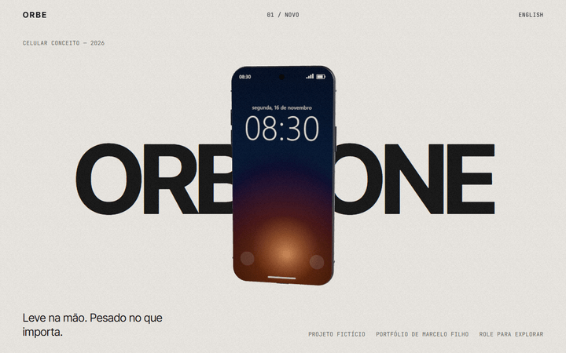

# Orbe One — vitrine 3D de um celular fictício

Página de lançamento de um celular que não existe, contada pelo scroll: o aparelho, modelado em código com Three.js, gira, aproxima a câmera, se desmonta em camadas e troca de cor conforme você rola.

**Demo:** https://<usuario>.github.io/vitrine-celular/ · Projeto de portfólio de Marcelo Filho.



> O Orbe One, a marca Orbe e todas as especificações são fictícios. Nenhuma marca, imagem ou texto de fabricante real foi usado.

## Destaques

- **Aparelho 100% em código.** Corpo, lentes, botões, tela e camadas internas são primitivas do Three.js, e a tela é desenhada num `<canvas>`. Não há modelo 3D nem foto baixada.
- **7 cenas ligadas ao scroll.** A pose de cada cena é uma função pura (`poseAt`, `sceneAt`, `stopsFor`), testada em unidade. Um ScrollTrigger aplica a pose a cada scroll, e o Lenis faz a suavização.
- **Vista explodida com rótulos.** As camadas se afastam em leque, e rótulos HTML acompanham cada uma, projetados do 3D para a tela no mesmo frame do render.
- **Funciona sem 3D.** Sem WebGL, sem JavaScript ou com `prefers-reduced-motion`, cada cena mostra um pôster gerado do próprio modelo (`npm run posters`), em AVIF/WebP de 4 a 9 KB.
- **Leve.** O JS inicial tem 1,3 KB. O Three.js (~190 KB gzip) só é baixado depois do `load`. O render acontece sob demanda (sem loop contínuo) e os shaders compilam em paralelo (`compileAsync`).
- **Bilíngue.** PT em `/` e EN em `/en/`, com `hreflang`, Open Graph e canonical por idioma.

## Números

Lighthouse 13.6, no preview local:

| Perfil | Performance | Acessibilidade | Boas práticas | SEO | LCP | TBT | CLS |
|---|---|---|---|---|---|---|---|
| Mobile | 98 | 100 | 100 | 100 | 2,3 s | 120 ms | 0,039 |
| Desktop | 100 | 100 | 100 | 100 | 0,5 s | 0 ms | 0 |

Com `npm run measure` (GPU real), não há nenhuma tarefa longa durante o scroll, e a página roda a 57–60 fps.

## Decisões que valeram a pena

- **Luzes diretas em vez de ambiente PMREM.** O `RoomEnvironment` compilava shaders de forma síncrona e travava a página por ~640 ms na primeira visita. As luzes compilam em paralelo com o resto.
- **Nada de criar contexto WebGL "só para testar".** A checagem de suporte acordava o processo da GPU e custava ~470 ms de TBT. Agora a checagem é pela API, e se o contexto real falhar a página cai nos pôsteres.
- **Estado observável para os testes.** A timeline publica `data-scene`, `data-layout` e `data-color` no DOM, e os testes leem isso em vez de comparar pixels do canvas.

## Stack

Astro 7 · TypeScript (strict) · Three.js 0.187 · GSAP 3.15 (ScrollTrigger) · Lenis 1.3 · Playwright + axe

## Comandos

```bash
npm install
npm run dev          # http://localhost:4321/vitrine-celular/
npm run build        # gera dist/
npm run check        # astro check
npx playwright test  # 78 testes: unidade, E2E desktop/mobile, acessibilidade
npm run posters      # regenera os pôsteres a partir do 3D
npm run gif          # regenera docs/demo.gif
npm run measure      # LCP, CLS, tarefas longas e FPS (com o preview na porta 4331)
```

O deploy no GitHub Pages roda a cada push na `main` (`.github/workflows/deploy.yml`).

---

**EN:** A scroll-driven launch page for a fictional phone, modeled entirely in code with Three.js and choreographed with GSAP ScrollTrigger and Lenis. It falls back to static posters without WebGL, JavaScript or with reduced motion, and scores 98 (mobile) and 100 (desktop) on Lighthouse performance. Portfolio project by Marcelo Filho.
